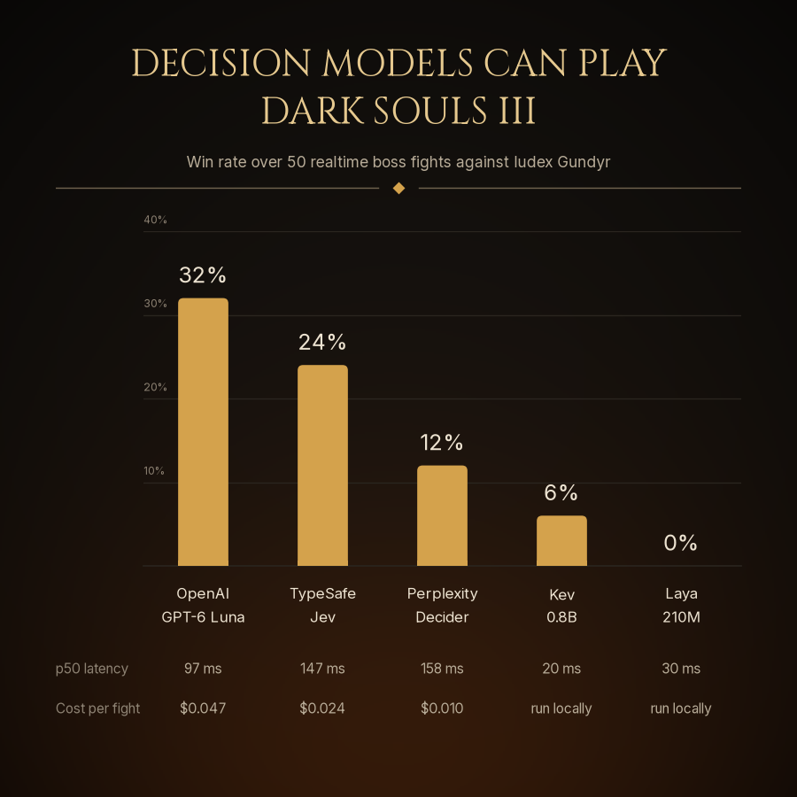

# Results: full fight, 50 seeds per model (2026-10-06/07)

**Setup.** `gundyr_full` (Iudex Gundyr, both phases, real HP, the kill plays on screen), seeds 0–49
for every model, true realtime (the game never pauses; each answer is applied the moment it
arrives), a 200 ms decide budget, one request per decision, and the same tuned System One prompt
and state for every model (`soulsbench/adapters/jev.py`, `prompt="tuned"`). Hosted models ran
interleaved by seed; the two local models each ran alone on the GPU with only their server loaded.

| model | N | wins (95% CI) | boss HP dealt | survival | p50 / p95 / p99 latency | timeouts | cost (50 fights) |
|---|---|---|---|---|---|---|---|
| OpenAI `gpt-6-luna` (Decisions API) | 50 | **32%** (21–46%) | 701 ± 264 | 118 s | 97 / 198 / 200 ms | 4.7% | $2.34 ($0.047 / fight) |
| TypeSafe Jev (`jev-latest`) | 50 | 24% (14–37%) | 698 ± 261 | 123 s | 147 / 200 / 200 ms | 5.0% | $1.20 ($0.024 / fight) |
| Perplexity `pplx-decider-v1-27b` | 50 | 12% (6–24%) | 484 ± 315 | 101 s | 158 / 200 / 200 ms | 9.3% | $0.52 ($0.010 / fight) |
| Kev 0.8B (local GPU) | 50 | 6% (2–16%) | 434 ± 265 | 53 s | 20 / 25 / 29 ms | 0% | $0 |
| Laya ~210M, `typed-decisions` checkpoint (local GPU) | 50 | 0% (0–7%) | 361 ± 272 | 23 s | 30 / 37 / 46 ms | 0% | $0 |

Boss HP pool: 1037. Cost is tokens × each provider's published per-token price, including warm-up
calls and answers that arrived after the deadline.

## Caveats

* **The prompt was tuned on Jev's runs.** Every model gets exactly the same input, but the rules
  were iterated against Jev, which may favour it.
* **p95 / p99 of 200 ms is the budget cap**, not a measured latency: answers slower than that are
  timeouts and play idle.
* **Perplexity's API degraded for about an hour** during the run. pplx's seeds 5–17 (12 fights)
  saw a ~200 ms median and no wins; on its other 38 fights it won 16% (6/38) with 609 average
  damage. The table reports all 50.
* **OpenAI's latency drifted** from ~95 to ~122 ms for a stretch (seeds 18–20) at the same time;
  it stayed under budget.
* **Not shown:** Cloudflare Clef and Clef-flash timed out on 100% of decisions at the 200 ms budget
  (~430–470 ms on Workers AI). Laya's default `english` checkpoint also ran 50 fights: 0% wins,
  314 average damage, 15 s survival.
* **Game RNG is not controllable**: seeds fix the adapter's RNG, not Gundyr's AI. With 50 fights per
  model, the OpenAI–Jev gap is within the confidence intervals.
* Aborted attempts (a DS3 hang, a stalled local server, one Perplexity outage) were excluded and the
  seed re-run, so every model has exactly 50 valid fights.

Reproduce with `scripts/run_full_bench.sh` (resumable). The chart is `scripts/win_rate_chart.py`.
